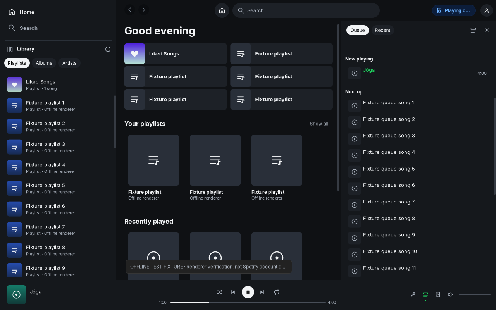
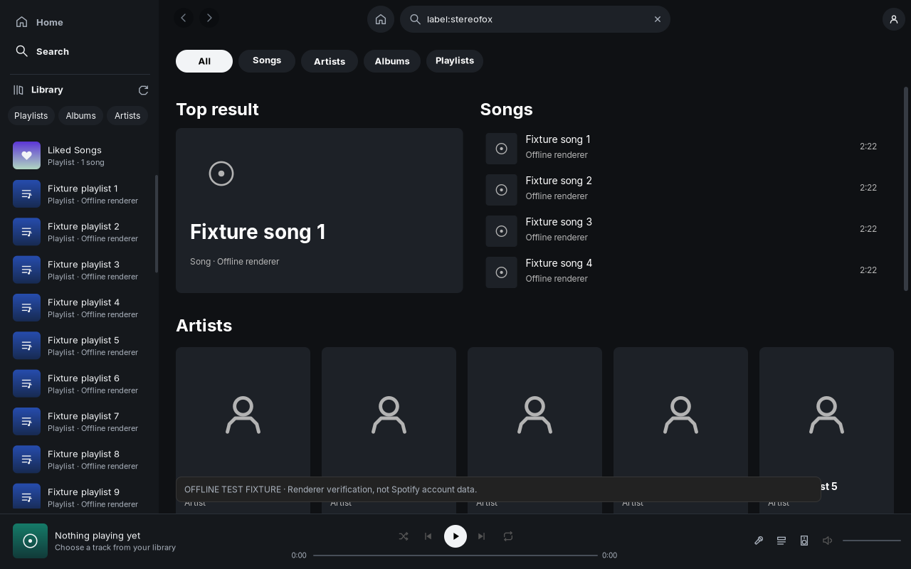

# Native Spotify

A Windows-first Spotify client with a shared C17 core and a modern, natively
rendered desktop UI. No Electron, WebView, GTK or Qt.

**Desktop is usable on Windows and Linux. Android is a work in progress.**

[Get started](#get-started) · [Build](docs/BUILDING.md) · [Android](android/README.md) · [Screenshots](docs/screenshots/README.md)

*Linux native renderer, using offline test fixtures—not a live Spotify account.
The screenshots show the actual client UI, not mockups.*

More screenshots

| Search | Album view |
| --- | --- |
|  |  |

[Login screen](docs/screenshots/desktop-login.png) · [Capture details](docs/screenshots/README.md)

## Features

- Search songs, artists, albums and playlists, with search history and filters.
- Browse your library, Liked Songs, artist pages, albums and recently played music.
- Play locally through [Spotify Soloist](https://developer.spotify.com/documentation/soloist),
  or transfer playback to another Spotify Connect device.
- Queue controls, shuffle, repeat, seeking, volume and synced lyrics from [LRCLIB](https://lrclib.net/).
- Resizable side panels and a collapsible library, with your desktop layout saved.
- Windows system media controls, keyboard navigation and native text rendering.
- Browser-based sign-in and OS-protected credentials. No client secret to configure.

Desktop rendering is event-driven: there is no permanent animation loop at rest.
The official Spotify desktop app does not need to stay open for local playback.

## Platforms

| Platform | Status | Frontend |
| --- | --- | --- |
| Windows 10/11 | Usable; primary platform | Win32 / GDI |
| Linux | Usable; X11 or XWayland required | Xlib / Cairo / Pango |
| Android 8+ (ARM64) | **Work in progress**; requires Termux | Jetpack Compose + shared C core |
| macOS | Not implemented | — |

Android runs Soloist through Termux and Debian on the phone, not inside the APK.
See the [Android setup guide](android/README.md) for its current requirements and
audio-verification caveats.

## Get started

Build the desktop client using the [Windows or Linux instructions](docs/BUILDING.md).
Keep the `assets/` directory beside the executable; CMake copies it for you.

1. Open the app and choose **Continue with Spotify**. Approve access in your browser.
2. Pick a track. For local audio, **Play on this computer** guides you through
   creating and pasting your own Soloist key. **Spotify Premium is required.**
3. Pair once from an official Spotify app on the same network: select
   **Native Spotify** in its device list. After pairing, the client manages the player.

The public client ID is built in; listeners do not need to register a developer
app. Soloist is downloaded from Spotify at runtime, not bundled or redistributed.
Linux also needs an unlocked Secret Service provider such as GNOME Keyring.

**Desktop shortcuts:** `Ctrl+L` focuses search, `Space` toggles playback outside
text fields, `Tab` / `Shift+Tab` moves focus, and `Escape` dismisses panels or popups.
Drag panel edges to resize; click the library icon to collapse or expand it.

## Scope and privacy

This is an independent project, not an official Spotify client or a complete
replacement. No offline downloads, live Friend Activity, full accessibility,
direct Wayland support or exact parity with Spotify's private recommendations.
Spotify API permissions, account restrictions and device capabilities still apply.

Sign-in uses OAuth PKCE in your browser. Refresh tokens and Soloist keys use
Credential Manager on Windows, Secret Service on Linux, and Keystore-backed
storage on Android—never a plaintext credential fallback. Lyrics lookup sends
track metadata to LRCLIB, not Spotify credentials. On desktop, Soloist receives
its key as a process argument; Linux users should consider `/proc` visibility.

Builds, automated tests and offline screenshots do not establish live playback
verification. Account consent and Soloist pairing require manual testing;
cross-building Windows is not Windows runtime verification. Spotify's
[Developer Policy](https://developer.spotify.com/policy) also applies.

## Development

The portable C core lives in `src/core/`, shared desktop presentation in `src/ui/`,
OS adapters in `src/platform/`, and the Android frontend in `android/`.

See [building and testing](docs/BUILDING.md), [Android development](android/README.md)
and the [visual references](design/REFERENCES.md). Follow `.clang-format` and keep
OS/UI dependencies out of the shared core.
