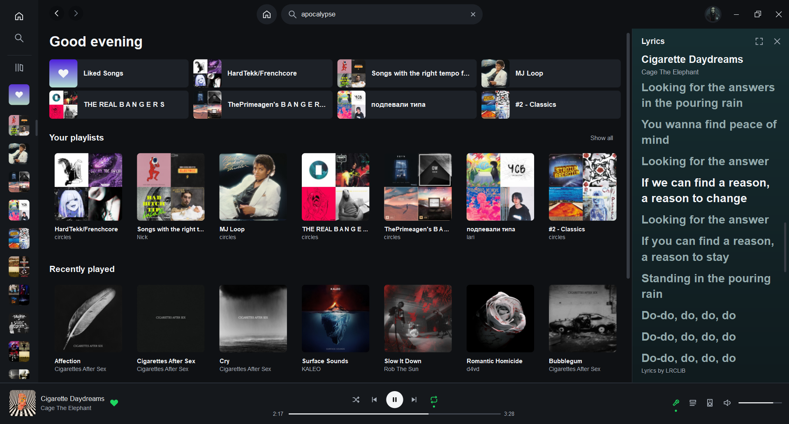
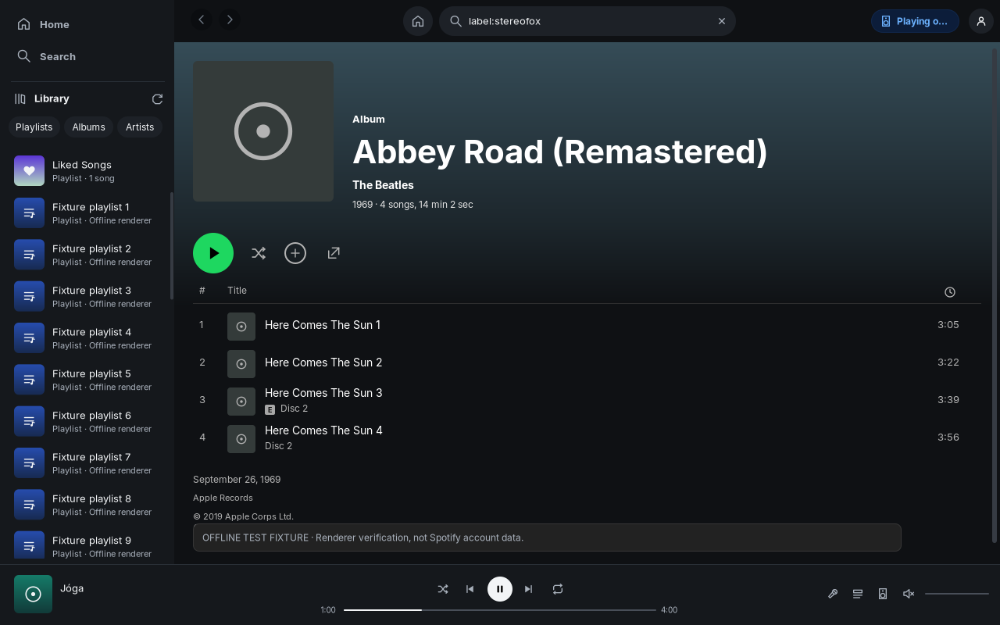
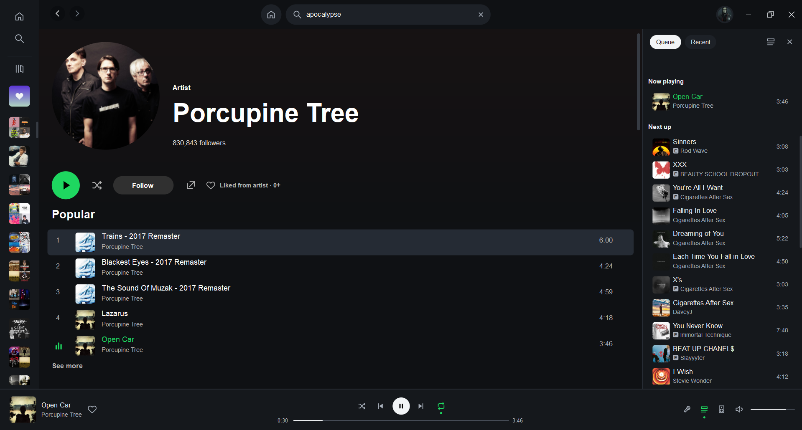
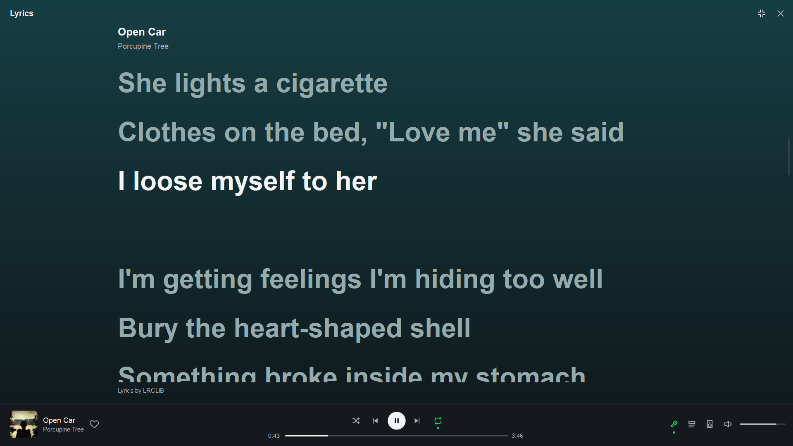

# Native Spotify

A Windows-first Spotify client with a shared C17 core and a modern, natively
rendered desktop UI. No Electron, WebView, GTK or Qt.

I built this because I was fed up with the official Spotify client's RAM usage
and wanted something lighter. This client uses around **20 MB of RAM in my
Windows setup**; usage varies with platform and workload, and Soloist runs separately.

**Desktop is usable on Windows and Linux. Android is a work in progress.**

[Get started](#get-started) · [Build](docs/BUILDING.md) · [Android](android/README.md) · [Screenshots](docs/screenshots/README.md)

*Windows desktop client with a collapsed library, recently played albums and synced lyrics.*

More screenshots

| Album view | Artist view |
| --- | --- |
|  |  |

## Features

- Search songs, artists, albums and playlists, with search history and filters.
- Browse your library, Liked Songs, artist pages, albums and recently played music.
- Play locally through [Spotify Soloist](https://developer.spotify.com/documentation/soloist),
  or transfer playback to another Spotify Connect device.
- Queue controls, shuffle, repeat, seeking, volume and synced lyrics from [LRCLIB](https://lrclib.net/).
- Resizable side panels and a collapsible library, with your desktop layout saved.
- Windows system media controls, keyboard navigation and native text rendering.
- Browser-based sign-in and OS-protected credentials. No client secret to configure.

Desktop rendering is event-driven: there is no permanent animation loop at rest.
The official Spotify desktop app does not need to stay open for local playback.

## Platforms

| Platform | Status | Frontend |
| --- | --- | --- |
| Windows 10/11 | Usable; primary platform | Win32 / GDI |
| Linux | Usable; X11 or XWayland required | Xlib / Cairo / Pango |
| Android 8+ (ARM64) | **Work in progress**; requires Termux | Jetpack Compose + shared C core |
| macOS | Not implemented | — |

Android runs Soloist through Termux and Debian on the phone, not inside the APK.
See the [Android setup guide](android/README.md) for its current requirements and
audio-verification caveats.

## Get started

Download the Windows or Linux x64 ZIP from [Releases](https://github.com/circles-00/native_spotify/releases/latest),
or [build from source](docs/BUILDING.md). Extract and run the executable—fonts and
icons are embedded directly in the binary, so no `assets/` directory is needed.
Linux packages require [system libraries](docs/BUILDING.md#prebuilt-linux-packages).

1. Create a free app in the [Spotify Developer Dashboard](https://developer.spotify.com/dashboard)
   (see Spotify's [App Setup Guide](https://developer.spotify.com/documentation/web-api/concepts/apps))
   and add `http://127.0.0.1:43821/callback` as a Redirect URI.
2. Open the app, paste your 32-character **Spotify Client ID** on the login screen
   (it is saved once and persisted across launches), and choose **Continue with Spotify**.
   Approve access in your browser.
3. Pick a track. For local audio, **Play on this computer** guides you through
   creating and pasting your own Soloist key. **Spotify Premium is required.**
4. Pair once from an official Spotify app on the same network: select
   **Native Spotify** in its device list. After pairing, the client manages the player.

No Spotify Client ID is hardcoded in the repository or release binaries; each
listener supplies their own Client ID once on first launch. Soloist is downloaded
from Spotify at runtime, not bundled or redistributed.

**Desktop shortcuts:** `Ctrl+L` focuses search, `Space` toggles playback outside
text fields, `Tab` / `Shift+Tab` moves focus, and `Escape` dismisses panels or popups.
Drag panel edges to resize; click the library icon to collapse or expand it.

## Scope and privacy

This is an independent project, not an official Spotify client or a complete
replacement. No offline downloads, live Friend Activity, full accessibility,
direct Wayland support or exact parity with Spotify's private recommendations.
Spotify API permissions, account restrictions and device capabilities still apply.

Sign-in uses OAuth PKCE in your browser. Refresh tokens and Soloist keys use
Credential Manager on Windows and Keystore-backed storage on Android. On Linux
they are stored as plain text files (mode 0600) in
`$XDG_CACHE_HOME/native-spotify/credentials`, so no keyring is required. Lyrics lookup sends
track metadata to LRCLIB, not Spotify credentials. On desktop, Soloist receives
its key as a process argument; Linux users should consider `/proc` visibility.

Spotify's [Developer Policy](https://developer.spotify.com/policy) also applies.

## Development

The portable C core lives in `src/core/`, shared desktop presentation in `src/ui/`,
OS adapters in `src/platform/`, and the Android frontend in `android/`.

See [building and testing](docs/BUILDING.md), [Android development](android/README.md)
and the [visual references](design/REFERENCES.md). Follow `.clang-format` and keep
OS/UI dependencies out of the shared core.

## Project status

This is a hobby project, maintained for my own needs. Updates, fixes and support
are not guaranteed. It comes with no warranty or security guarantees; use it at
your own risk.

## License

[MIT](LICENSE). Bundled dependencies and embedded fonts retain their respective
licenses: [Inter](assets/Inter-LICENSE.txt) (SIL Open Font License 1.1) and
[yyjson](vendor/yyjson/LICENSE) (MIT); both license texts are included in
`licenses/` in release packages. Spotify artwork, trademarks and other
third-party content are not covered by this license.
